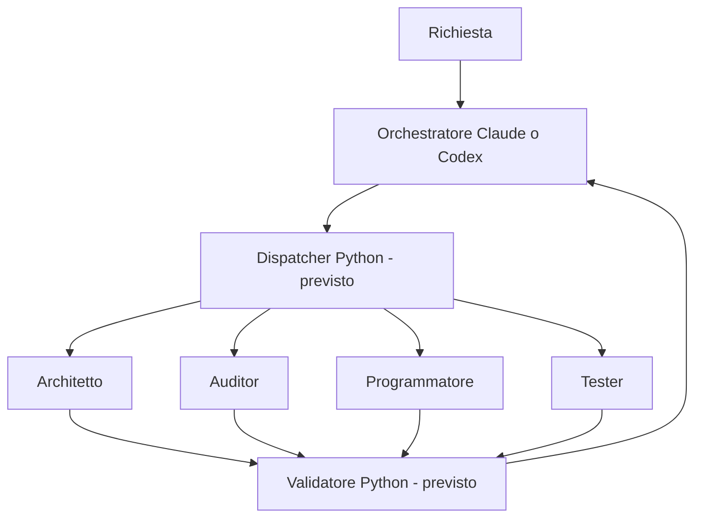

# Architettura di lavoro (proposta)

REA: analisi di software e binari con evidenze, quando pertinente. GrillMe: domande in progettazione e fix non banali. I diagrammi dei moduli reali stanno in `<progetto>/docs/`, non qui. Configurazioni e script Python non ancora realizzati.