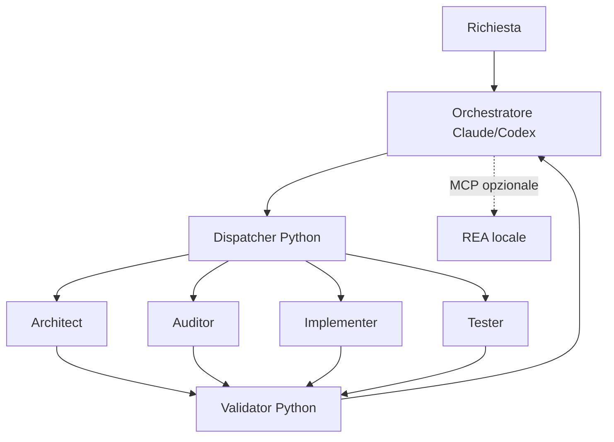

# Metodo condiviso

Il dispatcher avvia CLI solo con `--run`; non è un server sempre acceso. Il validatore controlla report, non attesta che le prove dichiarate siano autentiche. REA richiede installazione/configurazione sul PC prima di risultare operativo.
